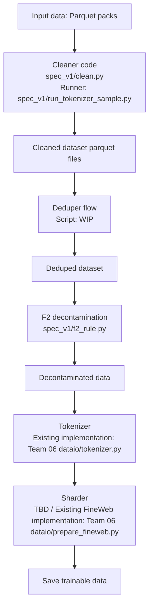

# Team 01-data-a

Put your work in a **topic folder**: `teams/01-data-a/<topic>/<file>`, for example `teams/01-data-a/harness/run.py`.
Team documents named in the week plan (for example `benchmarks_v1.md`) may sit directly in the team folder. The team lead decides the topic names. Do not make personal folders. Do not make new folders under `teams/`.
Open a pull request; the lead reviews and merges it. The pr-guard check must pass.

## Start here

| Task | Guide |
|---|---|
| Build, test, or run the cleaner | [Cleaner guide](spec_v1/README_clean.md) (how to run it), [spec and build flow](spec_v1/README.md) (rules policy and layout) |
| Review family medicines and decisions | [Sheet index](spec_v1/sheets/README.md), [science conflict review](spec_v1/sheets/medicine_sci_clash_resolution_and_harm_report.md) |
| Build gold or review contributor rules | [Shared tools](tools/README.md), [gold builder](tools/README_build_gold.md), [harm tests](harmtest/README.md) |
| Validate cleaner, privacy, or F2 behavior | [Build tools](spec_v1/build/README.md), [Validation tools](spec_v1/validate/README.md), [English checks](spec_v1/validate/README_english.md), [Indic checks](spec_v1/README_indic.md) |
| Run a sample job or inspect overlap results | [Jobs index](jobs/README.md) |
| Interpret validation evidence | [Results index](results/README.md) |

## Folder map

| Folder | What is in it | Tests |
|---|---|---|
| [gold/](gold/) | Gold sets: document IDs only, no text | none |
| [harmtest/](harmtest/README.md) | Harm test for a medicine or rule, and the contributor-medicine review tools. `tools/harm_test.py` is a forwarder to it, kept until Week 4 | `tests/harmtest/` |
| [tools/](tools/README.md) | Build gold sets, fetch medicines, view a pack | `tests/tools/` |
| [spec_v1/](spec_v1/README.md) | The cleaner: `clean.py`, `run_clean.py`, `normalize.py`, `f2_rule.py`, `run_tokenizer_sample.py` (the TSAI sample-job runner), with its `sheets/` | `tests/spec_v1/` |
| [spec_v1/build/](spec_v1/build/README.md) | Sheets to `clean.py`, and the Indic integration | `tests/spec_v1/` |
| [spec_v1/validate/](spec_v1/validate/README.md) | Checks on the sheets and on `clean.py` | `tests/spec_v1/` |
| [results/](results/README.md) | The reports our scripts write (IDs, counts, digests): `results/spec_v1/` holds the cleaner's harm tests, validation, Indic and F2 reports | none |
| [tests/](tests/) | The tests of every topic: `tests/spec_v1/` (the cleaner), `tests/harmtest/`, `tests/tools/`. `python -m pytest tests -q` runs all of them | none |
| [jobs/](jobs/README.md) | TSAI job requests, one folder for each job (config, manifest, local logs), and TSAI's returned results (paths set by `JOB_REQUEST.md`) | `tests/spec_v1/` |
| [rules/](rules/README.md), `medicines/` | Contributor registry snapshot; fetched annotator sheets (not committed) | none |
| [oneoff/](oneoff/README.md) | The scripts that made the code sheet, kept for the record; their owners prune them | none |

## Run it

From this folder (`teams/01-data-a/`), after `python3 -m pip install -r spec_v1/requirements.txt` once. A pack file is named `<pack_id>.parquet`, for example `en-dclm.parquet`.

| I want to | Command |
|---|---|
| Clean one pack | `python3 spec_v1/run_clean.py --pack ~/packs/en-dclm.parquet --out ~/clean_out` |
| Rebuild `clean.py` from the sheets | `python -I spec_v1/build/build_clean.py` (a test checks that it matches the committed `clean.py`) |
| Harm-test a rule or a medicine sheet | `python -I harmtest/harm_test.py --pack <pack>.parquet --gold gold/<pack>_gold.csv --rules <sheet.md> --rule all` |
| Fetch the contributors' medicines | `python -I tools/fetch_medicines.py` (add `--include-open-prs` with a GitHub token) |
| Build gold sets | `python -I tools/build_gold.py` (options in the [gold guide](tools/README_build_gold.md)) |
| Look at a pack | `python -I tools/view_pack.py <pack>.parquet` |
| Run the tests | `python -m pytest tests -q` for all of them (about 1,100 tests, 20 seconds), or one topic: `python -m pytest tests/spec_v1 -q`, `tests/harmtest`, `tests/tools` |
| Run the Gate 2 evidence tests | From the repository root: `python -m pytest teams/01-data-a/tests/spec_v1 -q`. The week plan still names the old `spec_v1/tests` path |

## Data preparation flow

Script paths in the cleaner and F2 nodes are relative to this folder. This diagram describes the intended stage order; the full flow is not yet wired into one runner.

- **Cleaner:** [clean.py](spec_v1/clean.py) implements the rules. [run_tokenizer_sample.py](spec_v1/run_tokenizer_sample.py) writes cleaned sample Parquet parts while preserving train/heldout splits. [run_clean.py](spec_v1/run_clean.py) is the single-pack/part runner.
- **Deduper:** A standalone dataset deduplication script is TBD.
- **F2:** [f2_rule.py](spec_v1/f2_rule.py) checks benchmark contamination using Team 09's fingerprint set. The existing `run_clean.py --f2` integration runs F2 immediately after cleaning; it does not insert the deduper stage shown above. The tokenizer-sample runner disables optional F2. TBD: separate decontamination stage with documents being marked for exclusion.
- **Tokenizer, sharder, and save:** Team 06's [tokenizer.py](../06-performance/dataio/tokenizer.py) provides `BrahmicTokenizer.encode()`. Its [prepare_fineweb.py](../06-performance/dataio/prepare_fineweb.py) tokenizes a raw FineWeb stream and writes train/validation `.bin` shards containing uint32 token IDs, plus `tokenizer.json.meta`. These are existing implementations for that FineWeb path; an adapter from the decontaminated Parquet dataset to this final stage is still TBD.
