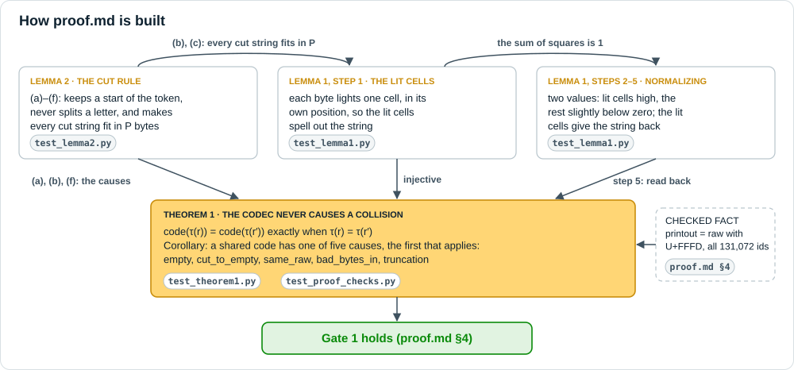
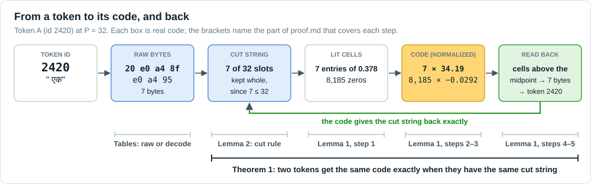
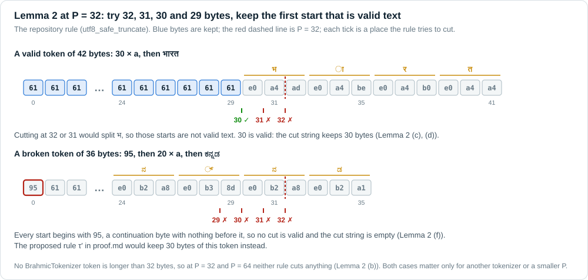
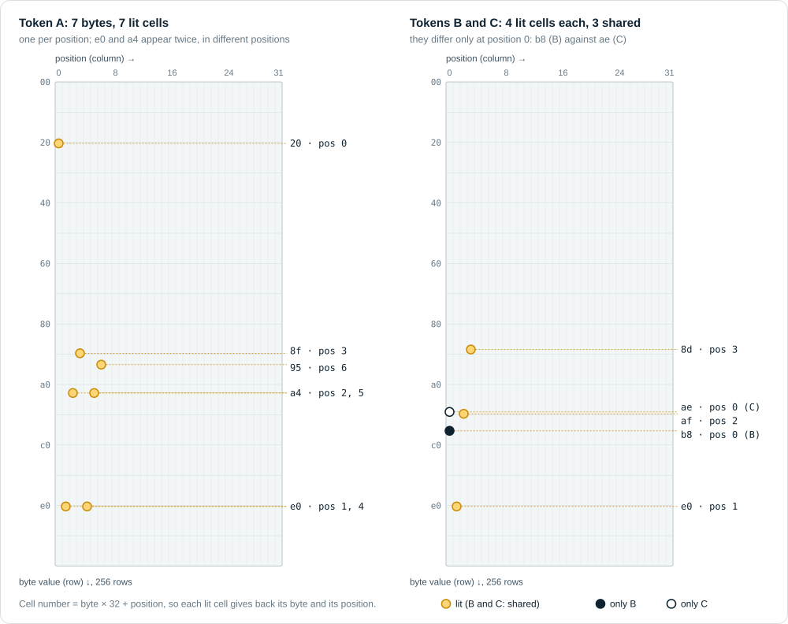
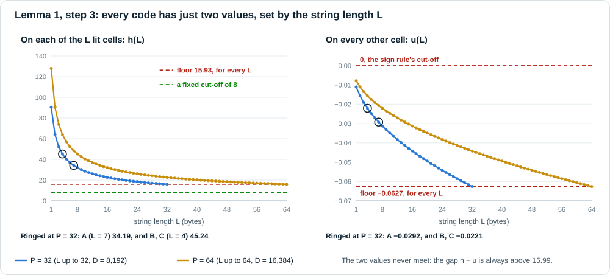
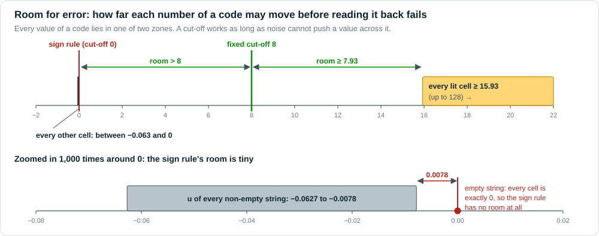
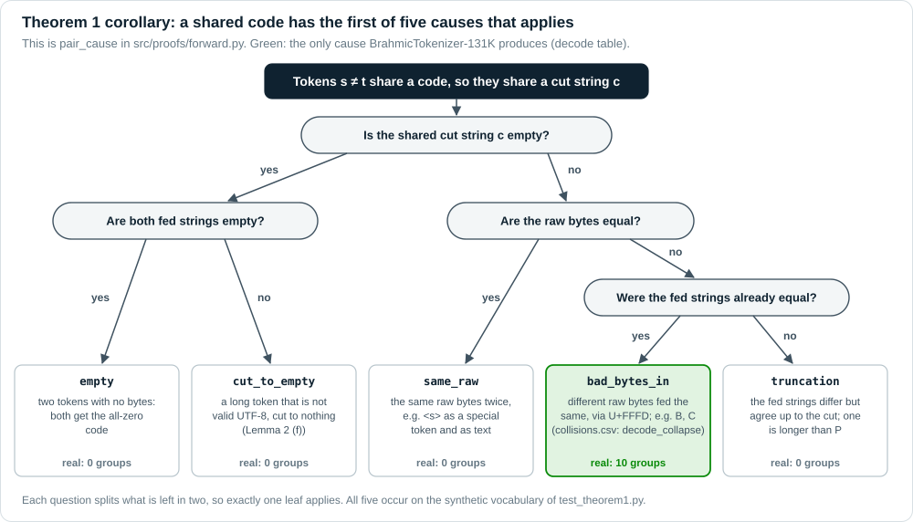
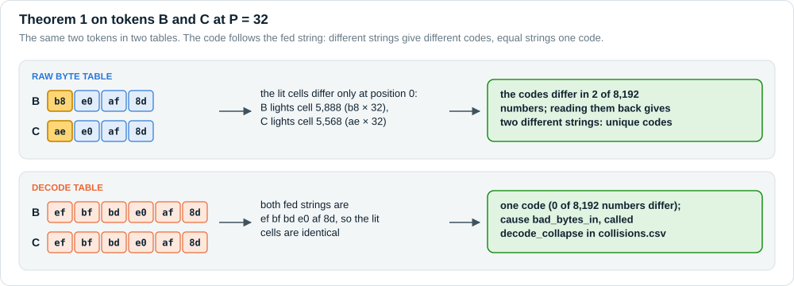

# KE2 week 1: the proof explained, with figures

A companion to [proof.md](proof.md), which states and proves Lemma 1, Lemma 2 and Theorem 1. This
document does not replace it and keeps its numbering, symbols and cause names. It adds:

- **figures** of each step, drawn from the upstream codec's own outputs;
- **one worked example**, three real tokens followed through every step;
- **a few quantitative results** that the proof relies on but does not state: bounds on the two code
  values for every string length, how much error reading a code back survives, and fp16.

Every number here is either quoted from a committed result file (named where it is used) or computed
and checked by [`src/docs/proof_figures.py`](src/docs/proof_figures.py), which also draws the figures
and stops if the codec and the closed forms disagree. An interactive version of the whole week is
[docs/ke2_week1_explainer.html](docs/ke2_week1_explainer.html), live at
https://yasirreshi.github.io/era-v5-lab/.

Symbols as in proof.md: $P$ is `pos_dim`, $D = 256P$, $r$ the raw bytes of a token, $s = \tau_P(r)$ the
cut string fed to the codec, $L = |s|$, $h$ and $u$ the two values of a code (Lemma 1, step 3).

## Contents

- [The running example](#the-running-example)
- [How proof.md fits together](#how-proofmd-fits-together)
- [From a token to its code](#from-a-token-to-its-code)
- [Lemma 2, the cut rule](#lemma-2-the-cut-rule)
- [Lemma 1, step 1: the lit cells](#lemma-1-step-1-the-lit-cells)
- [Lemma 1, steps 2 and 3: two values](#lemma-1-steps-2-and-3-two-values)
- [Lemma 1, steps 4 and 5: reading the string back, and how much error it survives](#lemma-1-steps-4-and-5-reading-the-string-back-and-how-much-error-it-survives)
- [Theorem 1 and its causes](#theorem-1-and-its-causes)
- [What is checked where](#what-is-checked-where)
- [Glossary](#glossary)

---

## The running example

Three real tokens of BrahmicTokenizer-131K appear in every section.

| | id | where it comes from | raw bytes | `decode([id])` bytes |
|---|---|---|---|---|
| **A** | 2420 | `" एक"` (Hindi "one") in भारत एक देश है, split 66526 · **2420** · 13092 · 732 | `20 e0 a4 8f e0 a4 95` | the same 7 bytes |
| **B** | 39329 | the end of மிஸ் ("miss"), split 4475 · 19844 · **39329** | `b8 e0 af 8d` | `ef bf bd e0 af 8d` |
| **C** | 74642 | the end of ம்ம் ("hmm"), split 4475 · 15336 · **74642** | `ae e0 af 8d` | `ef bf bd e0 af 8d` |

- **A** is an ordinary token: a space and two complete Devanagari letters.
- **B** and **C** are pieces of characters. The Tamil letter ஸ is `e0 ae b8`; the tokenizer split மிஸ்
  inside it, so B starts with the stray last byte `b8`, then the sign ் (`e0 af 8d`). C is the same with
  the letter ம (`e0 ae ae`).
- B and C differ only in their first byte, and neither first byte is a character on its own. So
  `decode([id])` prints both as U+FFFD followed by ். The raw byte table keeps them apart, and the decode
  table merges them: they are `group_id` 4 of the decode table in [results/collisions.csv](results/collisions.csv)
  (cause `decode_collapse`, class `Partial-UTF8[Tamil]`).

---

## How proof.md fits together



*Figure 2. Lemma 2 makes every cut string fit in $P$ bytes, which Lemma 1 needs. Lemma 1's lit cells
spell out the string, and normalizing keeps them apart, so the string can be read back: the codec is
injective. Theorem 1 follows, and its corollary names the five ways two tokens can still share a code.
The tags name the test files that check each part.*

**Why a proof is needed at all.** The collision count in `results/collisions.csv` compares table rows.
It says something about codes only if the codec never merges two different rows on its own. In principle
it could, in three places:

1. two bytes could light the same cell, and `scatter_add_` adds up whatever lands together (ruled out by
   Lemma 1, step 1);
2. normalizing uses a shift and a stretch that depend on the string itself, so two different strings
   could end up as the same numbers (ruled out by Lemma 1, steps 2 to 5);
3. rounding to float32, bf16 or fp16 could blur the values (proof.md's remark on floating point, and
   [below](#floating-point) for fp16).

The cut rule *can* merge strings, by cutting two long tokens to the same start. Lemma 2 and the
corollary of Theorem 1 say exactly when.

---

## From a token to its code



*Figure 1. Token A at $P = 32$. Its raw bytes become the cut string (Lemma 2), the cut string lights 7
cells (Lemma 1, step 1), normalizing turns them into two values (steps 2 and 3), and the lit cells give
the string back (steps 4 and 5). That round trip is why Theorem 1 holds.*

The codec in `kronecker_embeddings/codec.py` (upstream commit `d07cb54`), with what each line computes:

```python
lin_idx = bytes_long * pos_dim + pos                            # line 85   cell of byte v at position p: v·P + p
valid = pos < lens_long.unsqueeze(1)                            # line 88   only positions p < L count
scales = torch.rsqrt(lens_long.clamp_min(1).to(torch.float32))  # line 92   each lit cell is 1/√L
out.scatter_add_(dim=1, index=lin_idx, src=src)                 # line 99   light the cells
mean = out.mean(dim=-1, keepdim=True)                           # line 102  m
std = (out - mean).std(dim=-1, keepdim=True) + eps              # line 103  sigma = sqrt(v) + eps (unbiased)
out = (out - mean) / std                                        # line 104  z
```

---

## Lemma 2, the cut rule



*Figure 3. The repository rule tries $P$, $P-1$, $P-2$ and $P-3$ bytes and keeps the first start that is
valid UTF-8. Top: a valid token keeps 30 bytes, because cutting at 32 or 31 would split भ. Bottom: a token
that starts with a stray continuation byte keeps nothing.*

proof.md's six properties in plain words:

| | statement in proof.md | in plain words |
|---|---|---|
| (a) | $\tau_P(r)$ is a prefix of $r$ | the result is always a start of the token |
| (b) | if $\lvert r\rvert\le P$ then $\tau_P(r)=r$ | a token that fits is never touched |
| (c) | if $\lvert r\rvert>P$, $\tau_P(r)$ is valid UTF-8 and is empty or has $P-3$ to $P$ bytes | a cut string is valid text, and short only by a partial letter |
| (d) | valid UTF-8 stays valid and is never emptied | no letter is split, and valid text is never cut to nothing |
| (e) | $\tau_P(\tau_P(r))=\tau_P(r)$ | cutting twice changes nothing |
| (f) | if $\lvert r\rvert>P$ and $\tau_P(r)$ is empty, $r$ is not valid UTF-8 | only a broken long token can be emptied |

**On the running example.** A, B and C have 7, 4 and 4 raw bytes, and B and C print as 6 bytes. All
are at most 32, so by (b) each reaches the codec unchanged. The same holds for every token of
BrahmicTokenizer-131K: the longest has 32 bytes ([results/proof_checks.json](results/proof_checks.json),
`max_bytes`).

---

## Lemma 1, step 1: the lit cells



*Figure 4. The whole code at $P = 32$ drawn as a grid: 256 rows (byte values) by 32 columns
(positions), 8,192 cells. Left: token A lights 7 cells, one per position; `e0` and `a4` each appear
twice and land in different columns. Right: B and C share three lit cells and differ only at position 0.*

**Worked example: token A at $P = 32$.**

| position $p$ | byte | value $v$ | cell $v \cdot 32 + p$ | read back: cell div 32, cell mod 32 |
|---|---|---|---|---|
| 0 | `20` | 32 | 1,024 | 32, 0 |
| 1 | `e0` | 224 | 7,169 | 224, 1 |
| 2 | `a4` | 164 | 5,250 | 164, 2 |
| 3 | `8f` | 143 | 4,579 | 143, 3 |
| 4 | `e0` | 224 | 7,172 | 224, 4 |
| 5 | `a4` | 164 | 5,253 | 164, 5 |
| 6 | `95` | 149 | 4,774 | 149, 6 |

Seven bytes, seven different cells, each $1/\sqrt 7 = 0.37796$ before normalizing. The cell's remainder
mod 32 is its position, so a repeated byte still lands in a new cell.

**Tokens B and C.** B lights cells 5,888 (`b8` at 0), 7,169, 5,602 and 4,515; C lights 5,568 (`ae` at 0)
and the same other three. They share 3 of 4 cells. Before normalizing, the overlap of two codes is the
number of positions where the bytes agree divided by $\sqrt{|a|\,|b|}$, here $3/\sqrt{16} = 0.75$: close,
but not equal.

**Why the position matters.** Without the column, a string would be a bag of bytes, and `ab` and `ba`
would light the same cells. With it, `ab` lights $97P+0$ and $98P+1$, while `ba` lights $98P+0$ and
$97P+1$.

**Why strings must fit in $P$.** A byte $v$ at position $P$ would land on cell $vP+P = (v+1)P + 0$, the
cell of byte $v+1$ at position 0. Lemma 2 (b) and (c) make every cut string fit, and the codec accepts
exactly $P$ positions (`codec.py`, line 70).

---

## Lemma 1, steps 2 and 3: two values



*Figure 5. Left: the value $h$ on each lit cell falls as the string gets longer, because the same total
weight is shared by more cells. It never drops below 15.93. Right: the value $u$ everywhere else stays
negative and above −0.0627. The rings mark tokens A and B, C.*

proof.md derives $m = \sqrt L/D$, $v = (1-L/D)/(D-1)$, $\sigma = \sqrt v + \epsilon$ and

$$
h = \frac{1/\sqrt L - m}{\sigma}, \qquad u = \frac{-m}{\sigma}, \qquad h - u = \frac{1}{\sqrt L\,\sigma}.
$$

**Bounds for every length** (an addition; proof.md bounds only the gap). For $1 \le L \le P$:

$$
h \;\ge\; \sqrt{\frac{D-1}{P}}\cdot\frac{1-P/D}{1+\epsilon\sqrt D} \;>\; 15.93,
\qquad
-\frac{\sqrt P/D}{\sqrt{(1-P/D)/(D-1)}} \;\le\; u \;<\; 0 \quad(\text{so } u > -0.0627).
$$

*Proof.* $L^{-1/2}(1-L/D)$ decreases in $L$, so it is at least $P^{-1/2}(1-P/D)$, and
$\sigma \le (1+\epsilon\sqrt D)/\sqrt{D-1}$; dividing gives the bound on $h$. For $u$: $\sqrt L \le \sqrt P$,
and $\sqrt v$ decreases in $L$, so $\sqrt v \ge \sqrt{v_P}$. $u < 0$ because $m > 0$. $\square$

The values at selected lengths (closed forms; `proof_figures.py` checks the codec matches them at every
$L$ to a relative error below $10^{-5}$):

| $L$ | $h$, $P=32$ | $u$, $P=32$ | $h$, $P=64$ | $u$, $P=64$ | example |
|---|---|---|---|---|---|
| 0 | 0 | 0 | 0 | 0 | the empty string: every cell is exactly 0 |
| 1 | 90.4904 | −0.01105 | 127.9758 | −0.00781 | a single byte |
| 4 | 45.2369 | −0.02210 | 63.9820 | −0.01562 | B and C, raw |
| 6 | 36.9313 | −0.02707 | 52.2379 | −0.01914 | B and C, decode |
| 7 | 34.1896 | −0.02924 | 48.3614 | −0.02067 | A |
| 16 | 22.6019 | −0.04423 | 31.9793 | −0.03126 | |
| 32 | **15.9663** | **−0.06261** | 22.6017 | −0.04423 | the longest BrahmicTokenizer token |
| 64 | | | **15.9662** | **−0.06261** | possible only at $P = 64$ |
| bound | > 15.93 | ≥ −0.0626186 | > 15.93 | ≥ −0.0626205 | holds for every $L$ |

**Worked example: token A ($L = 7$) at $P = 32$.** $m = \sqrt 7/8192 = 0.00032297$,
$\sigma = 0.0110455$, so $h = 34.1896$ on the 7 lit cells and $u = -0.0292398$ on the other 8,185 cells.
The upstream codec in float32 gives 34.18963623 and −0.02923976.

---

## Lemma 1, steps 4 and 5: reading the string back, and how much error it survives



*Figure 6. Every value of a code lies in one of two zones: lit cells at 15.93 or above, every other cell
between −0.063 and 0. A cut-off works as long as noise cannot push a value across it.*

proof.md reads the lit cells as the cells above the midpoint $(h+u)/2$. Any cut-off $\theta$ strictly
between $u$ and $h$ works on a clean code. Two consequences matter for week 2, when codes come from a
model and are noisy (proof.md lists noisy decoding as not covered):

1. **A fixed cut-off of 8 works for every string**, with no need to know $L$ first: $h > 15.93 > 8 > 0 > u$
   by the bounds above. The empty string has no cell above 8, so it reads back as empty.
2. **Room for error.** If every number of a code is off by less than $\delta = \min(h-\theta,\ \theta-u)$,
   the cells above $\theta$ are still exactly the lit cells. Then:

| cut-off | room for error per number | note |
|---|---|---|
| midpoint $(h+u)/2$ | $(h-u)/2 \ge 8.0$ | best, but needs $h$ and $u$, so $L$ |
| fixed $\theta = 8$ | $\ge 7.93$ for every string | needs nothing |
| sign rule $\theta = 0$ | $\lvert u\rvert \ge 0.0078$, and **0** for the empty string | breaks on tiny noise |

**Worked example.** `proof_figures.py` adds uniform noise of up to 7.9 to every number of A's code: the
cells above 8 are still exactly A's 7 lit cells, while 4,061 other cells rise above 0 and fool the sign rule.

`decode_ref.py` takes a different route to the same goal: it compares a code with every token's code by
cosine and reports the gap between the best and the second best ([decode_ref.md](decode_ref.md)). That
margin is between tokens; the room for error here is per number of one code. Both say a clean code
decodes exactly.

### Floating point

proof.md's remark covers bf16: rounding is monotone, so it never swaps $h$ and $u$, and the gap stays
far above the bf16 spacing. The same argument covers fp16, whose relative error is $2^{-11}$ against
bf16's $2^{-8}$, and every $h$ (15.93 to 128) and $\lvert u\rvert$ (0.0078 to 0.0627) is in the normal
range of both formats. So after either cast $h \ge 15.935\,(1-2^{-8}) > 15.87$ and $u < 0$.
`proof_figures.py` checks this on the codec's output at every $L$, for both $P$: two values, $h > 15.87$,
$u < 0$, in bf16 and in fp16.

---

## Theorem 1 and its causes



*Figure 7. The corollary of Theorem 1 as a decision tree. It is `pair_cause` in `src/proofs/forward.py`:
each question splits what is left in two, so exactly one cause applies.*

The cause names differ between proof.md and the collision audit in `src/collisions/`:

| proof.md (`pair_cause`) | `results/collisions.csv` | meaning |
|---|---|---|
| `empty` | `empty` | two tokens with no bytes |
| `cut_to_empty` | (none: the raw table cuts plain bytes) | a long broken token cut to nothing (Lemma 2 (f)) |
| `same_raw` | `duplicate_vocab`, `special_literal` | the same raw bytes twice |
| `bad_bytes_in` | `decode_collapse` | different raw bytes, fed as the same bytes via U+FFFD |
| `truncation` | `truncation` | the fed strings agree up to the cut |

**Worked example: tokens B and C at $P = 32$.**



*Figure 8. Raw table: different strings, so different codes, which differ in exactly the two cells at
position 0. Decode table: the same fed string, so one code, and the cause is `bad_bytes_in`.*

| | raw byte table | decode table |
|---|---|---|
| fed strings | `b8 e0 af 8d` and `ae e0 af 8d` | both `ef bf bd e0 af 8d` |
| codes (8,192 numbers) | differ in exactly 2: cells 5,568 and 5,888 | identical |
| read back | two different strings | one string |
| cause | none, the codes differ | `bad_bytes_in` (`decode_collapse`) |

**Token A** has the fed string `20 e0 a4 8f e0 a4 95` in both tables, and no other token has it, so no
other token has A's code.

**For the whole vocabulary** ([experiment.md](experiment.md), [results/proof_checks.json](results/proof_checks.json)):
the raw byte table gives 131,072 distinct codes at $P = 32$ and $P = 64$; the decode table gives
129,931, and the 1,141 codes it loses form 10 groups, every pair `bad_bytes_in`.

---

## What is checked where

| claim | where it is proved | where it is checked |
|---|---|---|
| Lemma 2 (a) to (f) | proof.md §2 | `tests/test_lemma2.py` |
| Lemma 1, steps 1 to 6, with fp32 and bf16 | proof.md §1 | `tests/test_lemma1.py` |
| Theorem 1 and its five causes | proof.md §3 | `tests/test_theorem1.py`; real tokenizer: `tests/test_proof_checks.py`, `results/proof_checks.json` |
| the running example's bytes, lit cells, two values and B, C codes | this document | `src/docs/proof_figures.py` (it reads the tokens from the pinned tokenizer) |
| bounds on $h$ and $u$ for every $L$ | this document | `src/docs/proof_figures.py`, at every $L$ for $P = 32$ and $64$ |
| fixed cut-off 8 and the room for error | this document | proved; `src/docs/proof_figures.py` checks the noise example on token A |
| bf16 and fp16 keep two values, $h > 15.87$, $u < 0$ | proof.md remark; this document for fp16 | `src/docs/proof_figures.py`, every $L$, both $P$ |

To regenerate the figures (it also re-runs every check in the table above):

```bash
python teams/04-ke2/src/docs/proof_figures.py     # needs the tokenizer, found as in README.md
```

---

## Glossary

| term | meaning |
|---|---|
| raw bytes $r$ | a token's true bytes, read from the vocabulary piece |
| fed string, cut string $s$ | the bytes a table feeds to the codec, after the cut to $P$ bytes |
| lit cell | one of the $L$ entries a string switches on, at cell $v \cdot P + p$ |
| $h$, $u$ | the two values of a normalized code: on the lit cells, and everywhere else |
| cut-off, sign rule | reading back keeps the cells above a cut-off; the sign rule uses 0 |
| room for error | how far every number of a code may move before reading it back fails |
| U+FFFD | the replacement character, bytes `ef bf bd`, printed for broken bytes |
| continuation byte | a byte `80` to `bf`, the second to fourth byte of a UTF-8 letter |
