<p align="center">
  <picture>
    <source media="(prefers-color-scheme: dark)" srcset="figures/hero-dark.svg">
    
  </picture>
</p>

<p align="center"><sub>
fp8 and TurboQuant KV caches, measured in vLLM 0.33.0 and in an emulation &nbsp;·&nbsp; <code>sarvamai/sarvam-1</code> @ <code>e9607337</code> as a proxy &nbsp;·&nbsp; for <a href="../../docs/serving_plan.md"><code>serving_plan.md</code></a>’s “FP8 KV cache: measure first”
</sub></p>

<br>

**In one minute**

- **fp8 is the safe first step.** On sarvam-1 it holds about 2× the KV tokens with no measurable drift, and gives 19% more
  output tokens per second on an L4 (one timed run, end to end).
- **TurboQuant buys tokens with drift.** `turboquant_4bit_nc` adds 36–40% more tokens on top of fp8 for about +0.011 nats
  of next-token NLL (about +1% perplexity), and runs about 20% slower than fp8.
- **On our shapes, fp8 wins outright.** vLLM keeps two layers at each end in bf16, so on the dry-run-2 shape (T2, 8
  layers) `4bit_nc` would hold 1.57× bf16’s tokens, below fp8’s 2× (computed from vLLM’s slot sizes, not run).

> [!NOTE]
> A proxy: one model (28 layers, 8 KV heads, head dim 128), next-token metrics on training-sample text, no task scores,
> and not our model, whose checkpoint does not exist yet.

<br>

## 1 · vLLM 0.33.0

<p align="center">
  <picture>
    <source media="(prefers-color-scheme: dark)" srcset="figures/tradeoff-dark.svg">
    
  </picture>
</p>

One NVIDIA L4 per dtype on Modal; bf16 weights, `max_model_len` 2,048, `gpu_memory_utilization` 0.85, prefix caching
off. Drift is against the bf16 KV cache (`auto`) on 18 documents (3 per pack: English, Python, Hindi, Bengali, Tamil,
Kannada) × 1,024 tokens. Speed is output tokens per second over the whole `generate()` call for 64 prompts × (512 in,
256 out), prefill included. From [`results/vllm_summary.json`](results/vllm_summary.json).

| `--kv-cache-dtype` | KV tokens | vs bf16 | Bits per element¹ | tok/s | ΔNLL, nats (s.e.) | Docs worse | Same top-1 |
|:---|---:|---:|---:|---:|---:|---:|---:|
| auto (bf16) | 120,736 | 1.00× | 16 | 1,206 | | | |
| fp8 | 234,544 | 1.94× | 8 | 1,438 (+19%) | +0.0006 (0.0008) | 12/18 | 96.6% |
| turboquant_4bit_nc | 329,216 | 2.73× | 5.875 | 1,156 (−4%) | +0.0114 (0.0016) | 17/18 | 93.7% |
| turboquant_k3v4_nc | 354,592 | 2.94× | 5.446 | 1,077 (−11%) | +0.0336 (0.0029) | 18/18 | 89.3% |
| turboquant_3bit_nc | 385,440 | 3.19× | 5.018 | 1,085 (−10%) | +0.0501 (0.0034) | 18/18 | 87.8% |

<sub>¹ Averaged over all 28 layers, the 4 that vLLM keeps in bf16 included.</sub>

<details>
<summary><b>Reading the table</b>: capacity, fp8, noise, speed</summary>
<br>

- **Capacity matches the bit count.** Per slot, keys take ⌈128·b/8⌉ bytes plus an fp16 norm and values the same plus an
  fp16 scale and zero point: 4.19 / 3.69 / 3.19 bits on the compressed layers, 5.875 / 5.446 / 5.018 over all 28. Tokens ×
  bytes per token equal the KV memory vLLM reports (12.89–12.91 GiB), so the ratios are 16 / bits to within 0.2%.
- **fp8’s 1.94× is 2.00× per byte:** with fp8 (FlashInfer on the L4) vLLM leaves 12.53 GiB for the KV cache, against
  12.90 GiB for bf16. Per byte, 4bit_nc holds 1.36× fp8’s tokens (1.40× in tokens here).
- **fp8’s drift is within noise** (+0.0006, s.e. 0.0008, 12 of 18 documents worse). The TurboQuant presets are worse on
  17 or 18 of 18 documents.
- **Same top-1 has a floor below 100%:** two bf16 attention kernels alone agree on 98.8–99.8% of positions, so about a
  point of each figure may be kernel numerics.
- **Speed** is one timed run per dtype. All 64 sequences fit in every cache, so it is not capacity-bound; at this batch a
  decode step reads about as many KV bytes as weight bytes, which is the likely reason fp8 is faster.

</details>

### Why 2.7× and not 3.8×

<p align="center">
  <picture>
    <source media="(prefers-color-scheme: dark)" srcset="figures/layers-dark.svg">
    
  </picture>
</p>

In v0.33.0, `arg_utils.py` adds `min(2, layers // 2)` layers at each end (0, 1, 26 and 27 on sarvam-1) to the bf16 skip
list for every `turboquant_*` dtype on a model that is not an attention/Mamba hybrid; a user’s skip list can add layers
but not remove these. The “3.8×” of the `TurboQuantConfig` docstring is 16 / 4.1875, the compressed layers alone.

### How the drift was measured

<p align="center">
  <picture>
    <source media="(prefers-color-scheme: dark)" srcset="figures/prefill-dark.svg">
    
  </picture>
</p>

vLLM’s TurboQuant backend runs a prompt’s first prefill on the uncompressed K/V and reads the compressed cache only in
decode and in continuation chunks (`turboquant_attn.py`). A one-piece prefill therefore gives the same numbers for every
TurboQuant preset (the first attempt did). `drift()` in [`modal_vllm_kv.py`](modal_vllm_kv.py) prefills in 32-token
pieces, so each piece after the first attends through the compressed cache with the TurboQuant decode kernel, its own
tokens included, as decode does. The first 32 positions of each document are bit-identical to bf16 for the TurboQuant
presets; without them `4bit_nc` is +0.0117 (`k3v4_nc` +0.0347, `3bit_nc` +0.0517). fp8 reads its fp8 cache from the first
piece.

<br>

## 2 · Emulation

<p align="center">
  <picture>
    <source media="(prefers-color-scheme: dark)" srcset="figures/findings-dark.svg">
    
  </picture>
</p>

[`kvq_study.py`](kvq_study.py) fake-quantizes each key (after RoPE) and value vector per head and per token inside
attention (a transformers `AttentionInterface`), fp32 on Apple MPS, and compares the logits with the unquantized run:
mean KL(base ‖ quant), same top-1 and ΔNLL. Every position is quantized, the prompt included; in vLLM a prompt’s first
prefill uses exact K/V while later chunks and decode read the compressed cache, so the emulation is pessimistic for
prompt tokens and matches decode. TurboQuant here is TSAI’s V4 code (`lightninglm/tqp`: a Hadamard rotation with seeded
random signs and a Lloyd–Max codebook for the exact coordinate distribution); vLLM 0.33.0 uses a plain Sylvester
Hadamard and a Lloyd–Max codebook for N(0, 1/d).

**vLLM’s presets, emulated** — [`results/sarvam1_vllm_presets_T1024.json`](results/sarvam1_vllm_presets_T1024.json), the same 18 documents

| Preset | Emulated as | Bits | KL | Same top-1 | ΔNLL | vLLM ΔNLL |
|:---|:---|---:|---:|---:|---:|---:|
| fp8 | fp8 | 8 | 0.0028 | 96.9% | +0.0026 | +0.0006 |
| turboquant_k8v4 | fp8 / u4, without vLLM’s skip (7.54 bits with it) | 6.125 | 0.0066 | 95.7% | +0.0054 | not run |
| turboquant_4bit_nc | tqn4 / u4 @skip2 | 5.875 | 0.0141 | 93.8% | +0.0122 | +0.0114 |
| turboquant_k3v4_nc | tqn3 / u4 @skip2 | 5.446 | 0.0462 | 88.8% | +0.0409 | +0.0336 |
| turboquant_3bit_nc | tqn3 / u3 @skip2 | 5.018 | 0.0618 | 87.7% | +0.0548 | +0.0501 |
| k4v3, not a vLLM preset | tqn4 / u3 @skip2 | 5.446 | **0.0274** | 91.4% | +0.0212 | |

- **The emulation agrees with vLLM on the mean:** same order, within about 0.007 nats, and higher for every preset. Per
  document they agree less (correlation 0.36–0.67 across the 18 documents). Besides the kernels, the emulation runs in
  fp32, quantizes the first 32 positions that vLLM’s drift run keeps exact, and uses a different rotation and codebook.
- **Keys are more sensitive than values.** At the same 5.446 bits, 4-bit keys with 3-bit values have 41% less KL than
  vLLM’s `k3v4_nc`, lower on all 18 documents. vLLM has no such preset, so this is emulation only.
- **TurboQuant-prod (1-bit QJL residual) hurts attention:** 4.5–4.6× the KL of TurboQuant-MSE at the same bits, worse on
  18 of 18 documents ([`results/sarvam1_step1_T1024.json`](results/sarvam1_step1_T1024.json)), which agrees with vLLM
  leaving it out.
- **Norm correction (`_nc`) is free:** 16–17% less KL at no extra bits (18 and 17 of 18 documents).
- **TurboQuant against a plain int4 at 4 bits:** about 4× lower KL, on 24 of 24 documents
  ([`results/sarvam1_T1024.json`](results/sarvam1_T1024.json); 4 documents per pack).
  [`results/sarvam1_T4096.json`](results/sarvam1_T4096.json) has fp8, int4, TQ4 and TQ3 at 4,096 tokens (English,
  Python, Hindi and Kannada, 2 documents each).

<br>

## 3 · Our shapes

<p align="center">
  <picture>
    <source media="(prefers-color-scheme: dark)" srcset="figures/shapes-dark.svg">
    
  </picture>
</p>

The boundary skip does not shrink with the model. On the test shapes of `serving_plan.md` section 2 (2 KV heads × head
dim 64; dry run 2 is T2), v0.33.0’s slot sizes give 4.375 bits on the compressed layers for `4bit_nc`, and these KV
tokens against bf16 (computed, not run):

| Shape | Layers | `4bit_nc` | `k3v4_nc` | `3bit_nc` | fp8 |
|:---|---:|---:|---:|---:|---:|
| T1 | 6 | 1.32× | 1.34× | 1.36× | 2.00× |
| T2 (dry run 2) | 8 | 1.57× | 1.61× | 1.65× | 2.00× |
| T3 | 10 | 1.77× | 1.83× | 1.90× | 2.00× |

`4bit_nc` passes fp8’s capacity from 13 layers on, at head dim 64 or 128. So at our current depth fp8 would be ahead of
every TurboQuant preset on capacity too, not only on drift and speed as on sarvam-1.

**Not measured:** task scores (benchmarks run only under the eval firewall), our own model and MoE models, contexts
beyond 1k (drift) and 4k (emulation), KL in vLLM (only the top-1 log-prob is returned), and throughput with a batch large
enough to fill bf16’s cache, which is where extra capacity would turn into speed.

<br>

## 4 · Files and rerun

| File | What |
|:---|:---|
| [`kvq_study.py`](kvq_study.py) | the emulation; `--dump-docs` writes the documents as token ids for the vLLM run |
| [`modal_vllm_kv.py`](modal_vllm_kv.py) | the vLLM run on Modal: `run()` capacity and speed, `drift()` drift |
| [`vllm_summary.py`](vllm_summary.py) | the section 1 table and `results/vllm_summary.json` from the two Modal outputs |
| [`test_kvq.py`](test_kvq.py) | bit accounting, quantizers, metrics, the `@skip`/split logic and the summary (CPU, seconds; the TurboQuant tests need `LIGHTNINGLM`) |
| [`figures/make_figures.py`](figures/make_figures.py) | the figures above (light and dark), drawn from `results/` and vLLM’s slot sizes |
| `results/` | per-document metrics only: no text and no token ids |

<details>
<summary><b>Rerun everything</b></summary>
<br>

Clone TSAI’s V4 code (Apache-2.0) outside this repo, then, with `C` = the common arguments
`--lightninglm <LLM> --data <tokenizer_sample_v0_clean> --model sarvamai/sarvam-1 --revision e9607337286ddf496d4a2562b194e489dcf3feea --device mps`
and `SIX` = `en-fineweb-edu code-python ind-hi-fw2 ind-bn-fw2 ind-ta-fw2 ind-kn-fw2`:

```
git clone https://github.com/The-School-of-AI/LLM <LLM> && git -C <LLM> checkout 2c18402e
python kvq_study.py $C --packs $SIX --per-pack 3 --tokens 1024 --out results/sarvam1_vllm_presets_T1024.json \
    --methods fp8 fp8/u4 tqn4/u4 tqn4/u4@skip2 tqn3/u4@skip2 tqn3/u3@skip2 tqn4/u3 tqn4/u3@skip2
python kvq_study.py $C --packs $SIX --per-pack 3 --tokens 1024 --out results/sarvam1_step1_T1024.json \
    --methods fp8 tq4 tqn4 tqp4/tq4 tq4/tq3 tqn4/tqn3 tq3/tq4 tq3 tqn3 tqp3/tq3 tq4/tq2 tqn4/tqn2
python kvq_study.py $C --packs $SIX --per-pack 4 --tokens 1024 --methods fp8 int4 tq4 tq3 tq2 --out results/sarvam1_T1024.json
python kvq_study.py $C --packs en-fineweb-edu code-python ind-hi-fw2 ind-kn-fw2 --per-pack 2 --tokens 4096 \
    --methods fp8 int4 tq4 tq3 --out results/sarvam1_T4096.json
python kvq_study.py $C --packs $SIX --per-pack 3 --tokens 1024 --dump-docs docs.json
modal run modal_vllm_kv.py::main --docs-path docs.json --out-path vllm_capacity_speed.json
modal run modal_vllm_kv.py::drift_main --docs-path docs.json --out-path vllm_drift.json
python vllm_summary.py vllm_capacity_speed.json vllm_drift.json --out results/vllm_summary.json
python figures/make_figures.py
LIGHTNINGLM=<LLM> python test_kvq.py
```

</details>

<sub>The text is the train split of the cleaned tokenizer sample (v0); it, `docs.json` and the two Modal outputs stay on
the machine that has the data. No benchmark item is used. sarvam-1 is under the Sarvam AI Research License
(non-commercial and research use); no weights or outputs of it are redistributed here. The Modal runs were on a
member’s own account.</sub>
